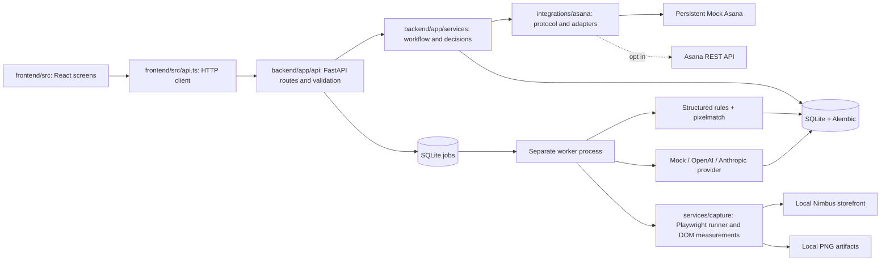

# Visual QA Bridge

A local, mock-first demonstration of **Asana request → browser evidence → AI first pass → human review → Asana follow-up → scoped recheck**. Nimbus Sleep Co., its products, comments, design frames and rules are synthetic. Chromium measurements are real results from the local demo storefront.

**Nothing is created in your real Asana account by default.** The visible `/mock-asana` board persists tasks, comments, subtasks, fields and attachments in SQLite. Real Asana is an explicit environment configuration; its adapter has not been verified against your trial account.

## Architecture and separation



The frontend never imports backend or Playwright code. API routes validate inputs and role labels; services implement business rules; the separate worker owns browser execution. Templates contain data, not executable AI-generated scripts.

## Setup

Prerequisites: Python 3.11+, Node.js 20+ with npm, and optionally GNU Make. First-time dependency/browser installation needs network access. Once installed, the default demo and tests run without API keys or external website access.

From the repository root:

```sh
make setup
make seed
make dev
```

Windows PowerShell, without Make:

```powershell
python -m venv .venv
.venv\Scripts\python.exe -m pip install -r requirements.txt
.venv\Scripts\python.exe -m playwright install chromium
Push-Location frontend
npm install
Pop-Location
.venv\Scripts\python.exe -m backend.app.seed
.venv\Scripts\python.exe -m scripts.dev
```

For this Codex workspace, dependencies are already installed. Start with the last two commands. If npm is unavailable in the bundled environment, the installed frontend tools can be invoked directly with Node, as shown below.

- App: http://127.0.0.1:5173
- Mock Asana board: http://127.0.0.1:5173/mock-asana
- Storefront: http://127.0.0.1:8000/demo-store/
- API/OpenAPI: http://127.0.0.1:8000/docs

Select **QA lead → Pull from Asana** to import the seeded board into the review workspace. Seeding and repeated pulls are idempotent. No `.env` is required for mock mode. To configure alternatives, copy `.env.example` to `.env`, edit it locally and restart all three processes. Keep `.env` untracked.

`make dev` supervises the API, worker and Vite frontend. Stop with Ctrl+C. If a previous terminal was forcibly closed, stop its processes before restarting; only one worker can hold the worker lock. The next worker recovers abandoned jobs, with a maximum of three attempts. After repeated failure the task returns to intake with “Recipe broken.”

For separate terminals:

```powershell
.venv\Scripts\python.exe -m uvicorn backend.app.main:app --host 127.0.0.1 --port 8000
.venv\Scripts\python.exe -m backend.app.worker
# In a third terminal, from frontend/:
node node_modules/vite/bin/vite.js --host 127.0.0.1
```

Optional Docker: `docker compose up --build`. Docker is not needed for local use; the Docker option has not been exercised in this workspace.

## Environment

| Variable | Default / meaning |
|---|---|
| `ASANA_MODE` | `mock`; set `real` only to use the REST adapter |
| `ASANA_PAT` | Server-side personal access token; empty in mock mode |
| `ASANA_PROJECT_GID` | `1000` for mock; your project GID in real mode |
| `AI_PROVIDER` | `mock`, `openai`, or `anthropic` |
| `OPENAI_API_KEY`, `OPENAI_MODEL` | Optional OpenAI credentials/model |
| `ANTHROPIC_API_KEY`, `ANTHROPIC_MODEL` | Optional Anthropic credentials/model |
| `LIVE_CAPTURE_ENABLED` | `false`; explicit opt-in required for other hosts |
| `CAPTURE_ALLOWED_HOSTS` | Comma-separated exact hostnames |
| `CAPTURE_CONTACT_EMAIL` | Identifying browser user-agent contact |
| `DATA_DIR` | `data`, containing `vqa.db` and artifacts |
| `DEMO_ORIGIN` | `http://127.0.0.1:8000` |
| `DEV_HOST` | `127.0.0.1`; Docker uses `0.0.0.0` |

Real Asana setup: use a dedicated demo project and configure its GID and PAT. The adapter reads standard fields `Target URL`, `Changed Sections` (JSON array of `{name, selector}`), `Viewports` (profile names), and `Design Spec` (a local design record ID for this prototype). Complete recipes and link local designs in the intake screen before capture. External design links are not treated as approved measurable specifications. `QA Status` is updated when the field/options are available; otherwise a comment records status. No real user is automatically assigned or invited. Assignment is a human action in Asana.

Push is a QA-lead action. Each summary carries a persisted hash; each confirmed defect has a stable marker, and repeated successful pushes do not duplicate comments/subtasks. The bridge appends comments and creates its own subtasks; it does not overwrite parent task notes. Screenshot upload failure is recorded without pretending a localhost URL is public. A network failure after a remote attachment upload can leave an uncertain upload; inspect Asana before retrying. Pull imports new tasks; it does not overwrite an ongoing local review with subsequent remote edits. Reconcile changed scope through a new request in this POC.

Real AI adapters receive only scoped requirements, comments, measured evidence and the relevant captured/design images. OpenAI uses a validated structured response; Anthropic returns schema-validated JSON. Unsupported output fails the job. Missing configured credentials produce clear errors; use `AI_PROVIDER=mock` for the fully offline demonstration. Consolidation remains explicitly labelled deterministic mock consolidation, even when a real vision provider is configured. Provider model defaults can be overridden for account availability.

Official implementation references: [Asana tasks](https://developers.asana.com/reference/createtask), [Asana attachments](https://developers.asana.com/reference/createattachmentforobject), [Asana rate limits](https://developers.asana.com/docs/rate-limits), [Playwright screenshots](https://playwright.dev/python/docs/screenshots), [Playwright emulation](https://playwright.dev/python/docs/emulation), [OpenAI structured outputs](https://platform.openai.com/docs/guides/structured-outputs), [Anthropic vision](https://docs.anthropic.com/en/docs/build-with-claude/vision).

## Evidence and safety

- Browser capture runs outside HTTP handling. Run scope freezes recipe, rule, design and viewport versions.
- Fixed timer, local assets, font/image waits, disabled animation, locale/timezone and named viewport profiles keep captures repeatable. Device profiles are emulation, not proof of real-device behaviour.
- Full-page and popup images provide context; changed-section crops and DOM measurements support specific claims. Hidden elements use full-page evidence plus visibility measurements.
- Image comparison uses Python pixelmatch: colour-distance threshold `0.1`, anti-alias pixels excluded, default acceptance tolerance `0.5%` changed pixels. The settings rule versions this tolerance. Difference PNGs are saved. Outside-scope changes use the union of declared section boxes as a mask and remain questions for humans.
- A Designer or QA lead must explicitly approve a full-page baseline in Captures. Recipe, profile, browser version and design version must match. Missing/mismatched baselines are **Blocked**, never false passes. Synthetic drawn design frames explain intent; they are not screenshot baselines.
- A pass covers the measured condition only. QA confirms defects and the Release owner approves release. Original F1/F2 remain separate unless explicitly grouped; F4 needs explicit element and viewport clarification.
- Only configured demo-origin navigation is allowed by default. Live mode requires an allowlisted hostname, robots.txt permission and three seconds between page loads per host. Checkout, payment, login and account paths are refused. Cart interaction requires an explicit recipe flag; unsafe steps or arbitrary JavaScript are refused. This is a constrained local tool, not a general hostile-site sandbox.
- Do not expose this prototype publicly: role labels are demonstration controls, not authentication.

## Tests and checks

```sh
make test
make lint
```

Equivalent commands using the installed tools on Windows:

```powershell
.venv\Scripts\python.exe -m pytest -q
.venv\Scripts\python.exe -m ruff check backend tests scripts
.venv\Scripts\python.exe -m mypy backend
node frontend/node_modules/typescript/bin/tsc -p frontend --noEmit
Push-Location frontend
node node_modules/vitest/vitest.mjs run
node node_modules/eslint/bin/eslint.js src
node node_modules/vite/bin/vite.js build
Pop-Location
```

Tests use a unique `data/tests/<id>` database, backend port 8001 and frontend port 5174; production demo data is untouched. The backend acceptance path launches real Chromium for both popups, confirms measured v1 failures, exercises human triage/sync/recheck/release, and checks v2 fixes and approved-baseline diffs. A browser smoke also opens the React app and follows its Mock Asana/metrics screens. React Testing Library tests verify role guidance and linked board comments.

## Ten-minute demonstration

1. **0:00–1:00 · G1, incomplete intake.** Start in Mock Asana: show CHG-101 and its missing changed sections. Switch to QA lead, pull tasks, and open CHG-101. Show its returned intake comment on the board. CHG-104 demonstrates a missing design; CHG-105 demonstrates prohibited checkout scope.
2. **1:00–2:00 · G6, preserve uncertainty.** Open CHG-101a → Queue. Show the six original comments, F4 Blocked, F3 awaiting content approval, and F1/F2 as a possible relationship with separate rows. Requirements/design frames are explicitly synthetic.
3. **2:00–3:00 · G3, repeatable evidence.** Switch to QA reviewer; capture CHG-101a v1. Inspect two recipes × three viewports in Captures. Open the mobile feature crop and see 14px; inspect the header’s 2px padding and HRS text.
4. **3:00–5:00 · G4/G5, targeted review.** Start human review. Filter measured findings; inspect representative screenshots and values, then explicitly select and triage the reviewed findings as valid with a reason. Filter unsupported AI claims: reject the warm-background suggestion as “not an issue”; record the Best value badge as “by design.” Batch selection applies your explicit decision to the selected IDs, not an AI decision. Add a manual concern to demonstrate a miss, or leave none if there is no new concern.
5. **5:00–6:00 · G6, clarify and consolidate.** Under Original comments, use “Clarify element & viewport” before confirming an ambiguous defect. For F4 choose `[data-testid=feature-list-premium]`, `mobile-390`, and the Standard popup recipe; record that this is a synthetic demo clarification. Keep F3 as a change request for Product owner approval. Resolve every automated finding before QA lead consolidation. Reject the F1/F2 merge because header and headline are distinct elements.
6. **6:00–7:00 · G2, show Asana actually changing.** QA lead syncs. Open the linked Mock Asana task: source IDs appear in a summary and only human-confirmed defects create Developer subtasks. Click sync again to show idempotency. No task is written to your real account in mock mode.
7. **7:00–8:30 · G3/G8, fix and scoped recheck.** Developer marks a confirmed font item fixed. In the separate storefront compare `?build=v1` with `?build=v2`. QA reviewer runs the affected-only recheck: scope and screenshots show only that selector/profile; the measured font becomes 18px and that queue item closes. Other unresolved items correctly remain open. Release owner attempting approval still sees blockers.
8. **8:30–10:00 · G7/G8, metrics and ownership.** Show AI valid/noise/miss rates and escaped defects in Metrics, separated from the supplied 84-minute pilot reference. Explain that elapsed stages include waiting and do not prove labour savings. Open Settings to compare prompt v1/v2 and rule versions. Name a skilled maintainer and backup; human functional/device/content checks remain outside browser automation. Sync the recheck result to close its Asana subtask.

The demo intentionally need not close every issue in ten minutes. The acceptance test runs the complete release path with explicit synthetic human decisions. For a new clean demonstration, set `DATA_DIR` to a new folder and seed it; this preserves the previous audit history.
